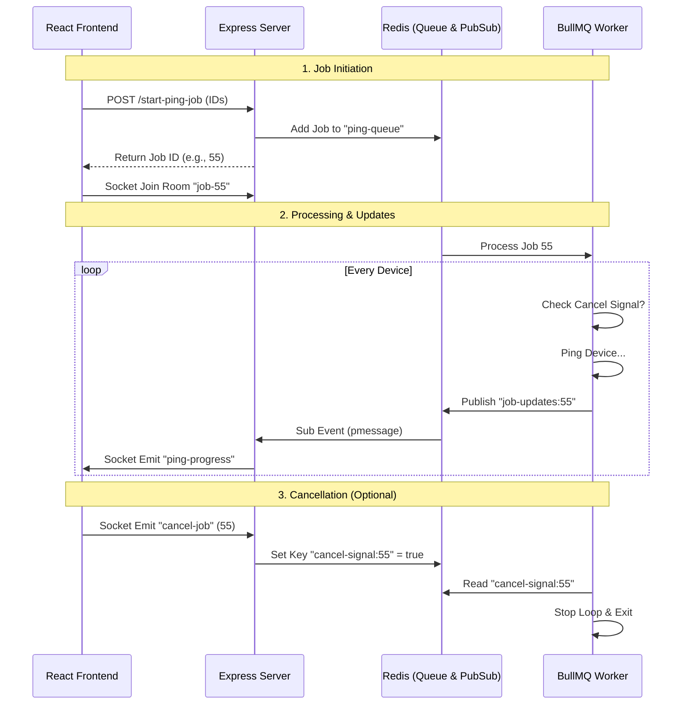

# Real-Time Device Pinger (React + Node + BullMQ + Redis)

This project demonstrates a real-time system where a frontend triggers long-running background tasks (pinging devices), receives live progress updates via WebSockets, and has the ability to cancel ongoing jobs.

## 🏗 Architecture Overview

The system uses a **"Bridge Pattern"** to connect background workers to the frontend UI using Redis Pub/Sub and Socket.io.


```text
ping-demo/
├── backend/
│   ├── server.js      # API & Socket.io Server (The Bridge)
│   ├── worker.js      # Background Processor (The Pinger)
│   └── package.json
└── frontend/
    ├── src/
    │   ├── App.jsx    # UI Logic & Socket Listeners
    │   └── main.jsx
    └── package.json
```
# Application Logic & Troubleshooting Guide

## 🧠 Logic Flow Explained

### 1. The Trigger (REST + Queue)
* **User Action:** Selects devices and clicks "Ping".
* **Frontend:** Sends a standard HTTP `POST` to the server with the list of IPs.
* **Server:** Does **not** ping immediately. It adds the task to **BullMQ** (Redis based queue) and immediately returns a `jobId`. This keeps the HTTP request fast.
* **Frontend:** Receives `jobId` and subscribes to a specific socket room: `socket.emit('join-job-room', jobId)`.

### 2. The Processor (Worker)
* **Worker:** Runs in a separate process (could be a different server entirely).
* **Action:** It pulls the job from BullMQ.
* **Loop:** It iterates through the device list.
* **Simulation:** It waits a random amount of time (simulating network latency) and generates a random success/fail status.

### 3. The Real-Time Bridge (Redis -> Socket)
* **Problem:** The Worker cannot talk to the Frontend directly (they might be on different machines).
* **Solution:** The Worker publishes the result to a **Redis Channel** (`job-updates:<jobId>`).
* **Server:** The API Server subscribes to `job-updates:*`. When it sees a message, it parses the `jobId` from the channel name and forwards the data to the matching Socket.io room.

### 4. Cancellation (Graceful Shutdown)
* **User Action:** Clicks "Cancel & Close".
* **Frontend:** Emits `cancel-job` via Socket.
* **Server:** Sets a temporary Redis key: `cancel-signal:<jobId>`.
* **Worker:** Inside its processing loop, checks for this Redis key before every single ping. If found, it aborts the loop immediately.

---

## 🔧 Troubleshooting

### Frontend fails to start?
* Ensure you are using Node v20+. Run `node -v`.
* If older, use `nvm install 22` to upgrade.

### No updates in the modal?
* Check **Terminal 3**. Is the worker running?
* Check **Terminal 1**. Is Redis running?
* Refresh the page. If the socket connection was lost, a refresh re-establishes it.

### CORS Errors in Console?
* Ensure `server.js` has `cors()` middleware enabled.
* Ensure Socket.io is configured with `cors: { origin: "*" }`.
